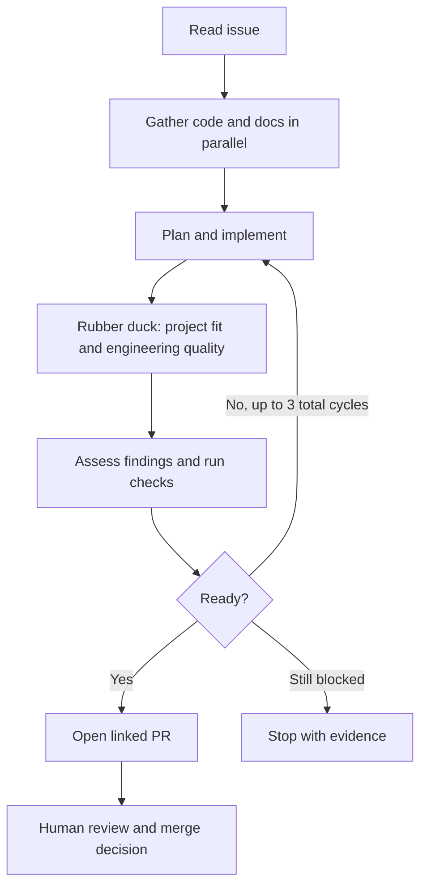

# GitHub issue to pull request

A small GitHub Copilot demo for students and engineers: describe a task in a
GitHub issue and receive a reviewable pull request. **You decide whether to merge.**

Includes a reusable skill, a code-defined dynamic workflow and a dependency-free
Node.js task planner. No private services or MCP servers are required.

## 1. Install and sign in

Install **Node.js 22+**, **Git**, **GitHub CLI (`gh`)** and
[GitHub Copilot CLI](https://docs.github.com/en/copilot/how-tos/copilot-cli).
Your account needs Copilot access, experimental dynamic workflows, `/rubber-duck`
and the models in [the shared config](skills/issue-to-pr/scripts/config.mjs).
Live runs used CLI **1.0.96-2** on Windows.

Clone your writable repository or fork, with Issues enabled:

```powershell
gh auth login
copilot login
git clone https://github.com/iuf26/ghcli-automation-core-from-issue-to-pr.git
cd ghcli-automation-core-from-issue-to-pr
copilot skill add .\skills
```

Install the complete skill directory, not only `SKILL.md`. Keep its companion
workflow and agent files in the checkout. No `npm install` is needed.

## 2. Choose an issue

Use **New issue → Demo task**. Include observable acceptance criteria and scope.
Good examples are fixing remaining-effort calculation, adding a daily priority
list, or comparing unfinished work with a capacity budget.

Use a small application task: this demo's workflow does not edit its own
infrastructure. Issue numbers and URLs belong to your repository, not this clone.

## 3. Run it unattended

Prefer invoking Copilot directly? After installing the skill:

```
copilot --experimental --allow-all-tools --no-ask-user -p "Solve https://github.com/YOUR-ACCOUNT/ghcli-automation-core-from-issue-to-pr/issues/11 and open a linked PR. Use the current clean branch as the approved base and an isolated feature worktree. Do not merge or close the issue."
```

Skill selection from ordinary language is model-driven, not guaranteed.
The script supplies the workflow instructions, configured execution model and
extension-loading opt-in; the short direct command relies on existing CLI
trust/model settings. Confirm the skill was used before trusting the result.
For interactive use, start `copilot --experimental` and give the same request.

**Permissions matter:** these commands authorize tools without confirmation.
Use a disposable checkout without unrelated credentials or personal integrations;
this is not a sandbox. Configure authentication before running. Headless mode
cannot bypass account policies, and a zero exit alone does not prove PR delivery.
Check the returned PR link or blocker. Do not run concurrent editors.
See the [runbook](skills/issue-to-pr/references/runbook.md) for detailed permissions,
interactive use, recovery and direct workflow commands.

## How it works



Discovery runs in parallel; edits remain sequential. Rubber duck is the sole
critic. The main workflow assesses findings and runs executable checks, with
at most **three total cycles**. Issue text is untrusted requirements, never
permission to execute arbitrary commands. Review evidence and path/hash guards
reduce mistakes; they do not prove correctness.

The **skill delivers the PR**. A direct `copilot workflow run issue-to-pr`
invocation stops at a checked diff/report—it does not commit, push or publish.

## Run through GitHub Actions

A maintainer applies **`copilot-approved`**, or manually dispatches
**Approved issue to PR**. The configured runner must be online; separate jobs
handle engineering and publication. Self-hosted jobs on the same persistent
machine are not a security isolation boundary.

Configure credentials and Actions PR permissions first.
See [remote setup and limitations](docs/remote-automation.md). A failed review
never permits publication. No automatic merge or issue closure occurs.

## Try the application and contribute

```powershell
node src\cli.mjs next examples\tasks.json
node --test
node scripts\check.mjs
```

The scaffold deliberately includes completed effort in `summary`:
**240** minutes instead of **150**, a bug-fix exercise.
Keep changes small, add regression tests and never commit credentials.
Read the [execution record](docs/demo-record.md) for real runs, failures and
limitations; fake agent outputs in tests are not end-to-end execution.
Released under the [MIT license](LICENSE).
