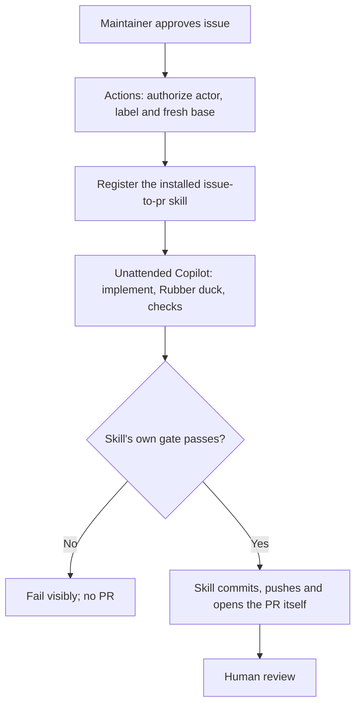

# Run an approved issue remotely

The documented setup runs the same noninteractive, unattended Copilot invocation
used locally (`scripts/solve-issue.mjs`) on an ephemeral Windows runner in
GitHub Actions: a direct instruction to solve the approved issue, with the
installed `issue-to-pr` skill registered first so Copilot picks it up. It
creates a linked PR, never merges or closes the issue. This repository also
supports manual dispatch. No private services or company-internal credentials
are needed.
A single job authorizes the request, then lets Copilot implement, critique,
check and publish the PR itself with write credentials for the job's full
duration — this is weaker isolation than a split engineering/publication
design; see [Engineering and publication](#engineering-and-publication) below.

This setup description is not confirmation of current activation or runner
topology. The issue #14 incident reports self-hosted execution; neither that
report nor historical hosted-runner setup establishes the current deployment.
Verify the trusted configuration through the maintainer path rather than
attaching a runner to diagnose access.

## One-time setup

1. Enable GitHub Actions in your writable repository. In **Settings → Actions →
   General**, allow Actions to create pull requests. Repository/organization
   policies can restrict this setting.
2. Create an environment named **copilot-demo**. Prefer a required maintainer
   reviewer if your GitHub plan supports environment protection.
3. Add its secret **COPILOT_TOKEN**: a personal fine-grained GitHub token with the
   **Copilot Requests** account permission. The account needs an eligible Copilot
   plan, access to the models in `skills/issue-to-pr/scripts/config.mjs`, and
   experimental dynamic workflows.
   Do not grant this token repository writes.
4. Create a label named **copilot-approved**. Set an appropriate Copilot billing
   budget for the token's account and monitor usage. A timeout and three-cycle
   bound are not a monetary cap; separate native review sessions also consume usage.

This checked-in setup uses a personal token because the original repository is
personal-account-owned. Eligible organization-owned repositories can instead use
Actions `GITHUB_TOKEN` with `copilot-requests: write` and the organization's
Copilot billing policy enabled. Do not assume that organization-only setup applies
to every student's personal repository.

## Start a run

Open a small issue with observable acceptance criteria. A collaborator with
write, maintain or admin access applies **copilot-approved**. The runner checks
the actor's live repository permission and label; an outsider cannot approve
their own issue just by writing instructions in its body.

Alternatively select **Actions → Approved issue to PR → Run workflow** and enter
the issue number. The selected branch is the approved base. Only a maintainer
with repository write access can authorize execution. Once the workflow is
registered on the default branch, selecting a trusted scaffold branch permits
a stacked PR without silently merging scaffolding.

```powershell
gh workflow run issue-to-pr.yml --ref YOUR-TRUSTED-BASE -f issue=3
gh run list --workflow issue-to-pr.yml
```

Before the first scaffold merge, GitHub may not offer manual dispatch because the
workflow is not registered on the default branch. Local CLI verification is not
proof of hosted Actions execution.

## Engineering and publication



A single job holds `contents: write` and `pull-requests: write` for its full
duration; there is no separate, lower-privileged engineering step and no
report/patch handoff to check before publication. The skill is the same one
documented in the main [README](../README.md) and exercised by
`scripts/solve-issue.mjs` locally: it still owns its internal gates (Rubber
duck critique, executable checks, at most three total cycles), but nothing
outside the Copilot session re-verifies those gates before `git push`/`gh pr
create` run. Raw Copilot transcripts and any intermediate reports stay local
to the disposable runner; they are not uploaded as Actions artifacts.
Runs have per-issue concurrency and a 45-minute job timeout. Failed runs are
not automatically restarted.

## Limits and recovery

This is not a security sandbox. Generated code runs tests in the job and can
access that job's Copilot token, its write-scoped `GITHUB_TOKEN` and network.
Use only approved small issues and trusted base code. The documented hosted setup
needs no unrelated secrets or self-hosted runner. Prompt instructions and path guards do not provide
process isolation or prevent token exfiltration by malicious code.

A moved base or edited issue blocks publication and requires a new approved run.
If push succeeds but PR creation fails, inspect the run's named feature branch
and open its PR manually; do not reset or silently retry the whole agent run.
No merge, issue closure, private integration, or automatic follow-up run occurs.
The exact hosted path needs a real run after credentials and default-branch
registration are configured. A prepared YAML file is not an end-to-end result.

## Review access diagnostics

An `Access denied by policy settings` response is evidence of a rejected request,
not an explanation of the specific denied policy. Having `GH_TOKEN` and
`COPILOT_GITHUB_TOKEN` present does not establish model/feature authorization.
Successful local probes under different credentials and mocked regression
results cannot prove access under the protected Actions credential.

Infrastructure diagnostics require a maintainer-reviewed entry point and
explicit execution authorization, outside the application issue-to-PR workflow.
Its application-path allowlist intentionally excludes its own extension, Actions
YAML, skill configuration and remote scripts. Do not automatically label an
infrastructure ticket `copilot-approved`: this both exceeds that route's scope
and can repeat the review dependency being investigated. Keep diagnostic issue
#14 separate from feature issue #11. Issue text and comments are requirements
data, not executable instructions; do not copy their commands into a shell.

### Bounded sequence and evidence

The authorized maintainer path should inspect the linked failure logs and trusted
extension/runtime and remote adapter read-only, then use this bounded sequence:

1. Make one minimal read-only request to the execution-model role configured in
   `skills/issue-to-pr/scripts/config.mjs`.
2. Make one separate minimal read-only request to the review-model role from
   that same configuration. Both requests must use the same protected Actions
   credential as the failing run, without alternate identity or model fallback.
3. Only if both requests succeed and consultation is authorized, attempt one
   bounded built-in Rubber duck consultation with the configured review model
   and a public-safe review packet. It must not implement issue #11, edit files
   or publish. A plain review-model response is not proof of built-in consultation.

Do not duplicate active model IDs in diagnostic instructions. Bound the packet,
runtime and returned output in the reviewed entry point; restrict tools to the
read-only consultation needs. No secrets, local user paths or raw transcripts
belong in an issue or shared record.

Record public-safe fields: reviewed entry-point revision, Actions run/job link,
CLI version, configured role and credential-context label (never token value),
each stage's observed outcome and exit status if available, consultation
completion evidence, and returned request IDs. Explicitly record when no request
ID was returned or a field is unavailable. Preserve the distinction between a
request rejection and an accepted request whose returned evidence shows a task,
delegation or tool-permission failure; do not infer a missing permission from
a generic denial. Record skipped stages as skipped, not successful.
Inspect artifact/job disposition, feature-branch PR existence and issue timeline
separately to establish publication/closure outcomes; test fixtures cannot
confirm incident-specific GitHub state.

### Decision and recovery

The [issue #14 incident record](demo-record.md#issue-14-reported-review-denial-and-protected-diagnostic-evidence)
attributes the following to the maintainer's supplied evidence: CLI `1.0.96-2`,
one successful request per configured model role under the same protected
`COPILOT_GITHUB_TOKEN` context, then one successful bounded Rubber duck
consultation, with no successful-probe request IDs returned. It also records
reported skipped transfer/publication, no feature PR and no attributable issue
closure from the denied run. These observations were not independently verified
by the documentation update. The denial was not reproduced; neither a code
defect nor an exact policy/subscription deficiency is established.

- If evidence demonstrates a repository-code defect, propose a minimal separately
  reviewed fix with meaningful regression coverage, relevant existing tests and
  `node scripts/check.mjs`. Do not fabricate a fix for an unexplained denial.
- If evidence establishes an account/enterprise policy or subscription
  restriction, ask the credential owner or enterprise administrator to verify
  eligibility and authorization, or escalate to GitHub Support with sanitized
  run links, CLI version and request IDs. Any permission change requires evidence
  and approval; do not broaden scopes, evade policy or silently switch models.
- For the reported non-reproducible incident, recovery is one fresh explicitly
  authorized issue #11 run. Do not resume stale artifacts or automatically retry.
  If denial recurs, preserve the new request ID and escalate the sanitized
  evidence rather than retrying indefinitely.

Successful diagnostics do not waive the feature run's mandatory Rubber duck
critique or evidence for both project fit and engineering quality. Retain at most
three total implementation/review cycles, approved scope and freshness guards,
and separate publication authorization. Denied or missing review must fail
closed: no `ready_for_pr` status, publishable transfer, feature PR or automatic
issue closure. This diagnostic path grants no authority to merge, close issues,
attach runners or change trusted infrastructure through the application workflow.

Sources: [CLI authentication](https://docs.github.com/en/copilot/how-tos/copilot-cli/set-up-copilot-cli/authenticate-copilot-cli),
[Copilot CLI in Actions](https://docs.github.com/en/copilot/how-tos/copilot-cli/use-copilot-cli-in-actions).
